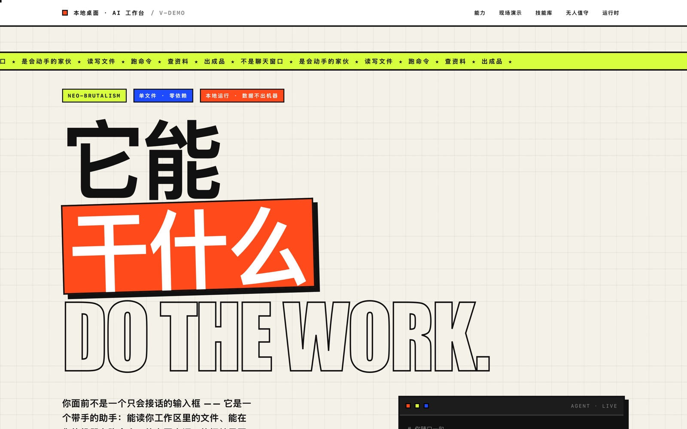
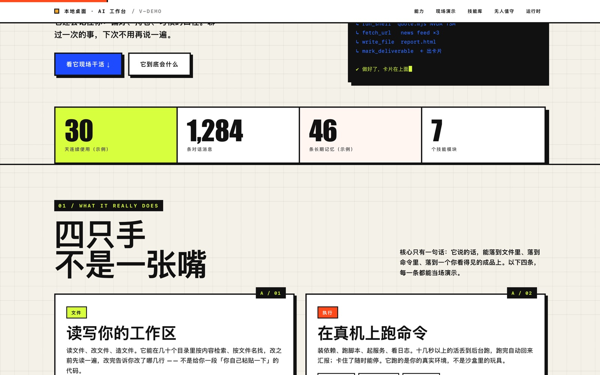

# skills

一组给「能动手的 AI 助手」用的技能包：每个目录是一个自包含的 `SKILL.md`（何时用、怎么做、怎么验收），需要脚本的随包带上。




## 包含

| 技能 | 干什么 | 触发说法 |
| --- | --- | --- |
| [`neo-brutalist-page`](skills/neo-brutalist-page) | 用新粗野主义（Neo-Brutalism）风格做单文件 HTML 宣传页／落地页／能力展示页／数据报告页。含固定色板与排版 token、组件配方、必做交互清单、禁忌清单、Bun.WebView 自检脚本，以及一份 795 行的完整参考实例 | 「做个宣传页」「做得酷一点」「粗野风」 |

## 安装

技能就是目录。放进宿主的技能根即可，两种方式：

```bash
# 1) 宿主支持 install_skill（工作区路径 → 用户级技能根）
#    先把仓库放进工作区，然后让助手执行 install_skill("skills/neo-brutalist-page")

# 2) 手动：直接拷进技能根
git clone https://github.com/<you>/skills.git
cp -R skills/neo-brutalist-page ~/.my-app-ui-local/skills/   # 路径按你的宿主改
```

装好后在会话里说一句「做个宣传页」就会命中。

## 单个技能的用法

`neo-brutalist-page` 的自检脚本（写完页面**必须**跑一遍，别只看渲染结果）：

```bash
bun run skills/neo-brutalist-page/scripts/selfcheck.ts path/to/page.html 8811 \
  --click "#replay"          # 可选：展开后点击的元素，验证交互没坏
```

它会：起本地 HTTP 服务 → 在 `Bun.WebView` 里打开页面 → 收 `window.onerror` → 断言无横向溢出、无文字被裁、没有元素卡在透明状态 → 桌面 6 段 + 窄屏 2 段截图 → 退出码直接给出成败。

## 前提

- 自检脚本需要 **Bun 1.4+**（用内置 `Bun.WebView`，无需装依赖）；`Bun.WebView` 驱动本机 Chrome/Edge，需本机装有其中之一。
- 页面本身是**单文件、零依赖、断网可开**的纯 HTML/CSS/JS，与宿主无关。
- 自检脚本在 macOS 上实测通过；其它平台预期可用但未实测。

## 许可

MIT，见 [LICENSE](LICENSE)。拿去改、拿去商用都行，别拿去做成付费课程的封面就行。
