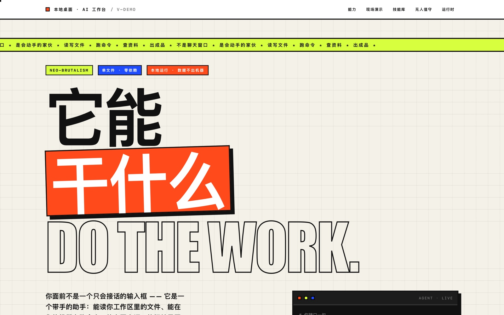
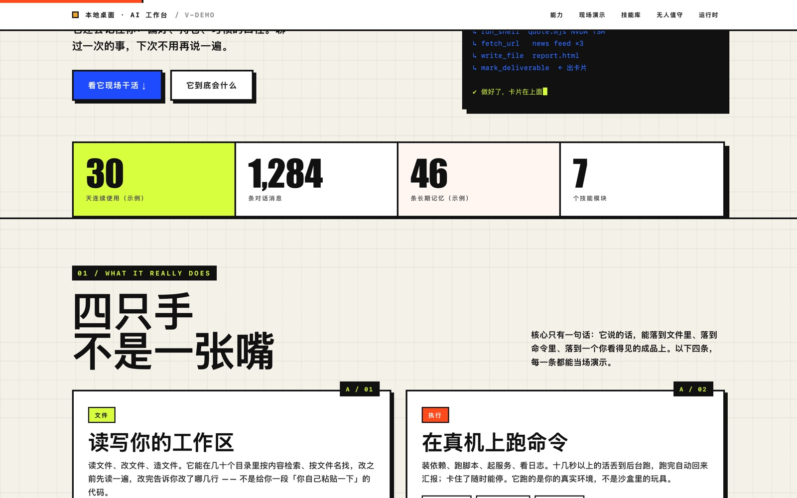
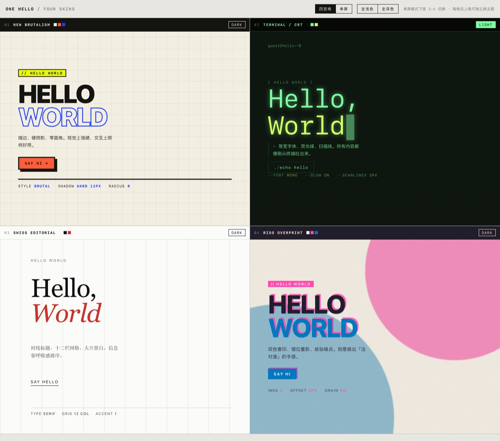

# skills

一组给「能动手的 AI 助手」用的技能包：每个目录是一个自包含的 `SKILL.md`（何时用、怎么做、怎么验收），需要脚本的随包带上。





## 包含

| 技能 | 干什么 | 触发说法 |
| --- | --- | --- |
| [`neo-brutalist-page`](skills/neo-brutalist-page) | 用新粗野主义（Neo-Brutalism）风格做单文件 HTML 宣传页／落地页／能力展示页／数据报告页。含固定色板与排版 token、组件配方、必做交互清单、禁忌清单、Bun.WebView 自检脚本，以及一份 796 行的完整参考实例 | 「做个宣传页」「做得酷一点」「粗野风」 |
| [`admin-console-ui-design`](skills/admin-console-ui-design) | 后台管理台（admin console）的视觉与交互系统：左侧栏 + 顶栏的应用壳、KPI 卡／对象卡／表格／表单／弹窗／登录页的组件配方、语义 token 与状态色映射、抓取页面的四种状态（loading／error／empty／success）、无障碍与键盘约束。React 19 + Tailwind v4；包名、路由、i18n、品牌名等占位符按项目替换 | 「做个后台页面」「管理台的列表页／表单／弹窗」「统一一下设计 token」「做个登录页」 |
| [`web-style-skins`](skills/web-style-skins) | 「一份 DOM、多套皮肤」：内置三套已验证的风格配方（新粗野主义／终端 CRT／瑞士国际主义排版，参考实例里再加一套 Riso 套印），含每套的色板与排版 token、共享 DOM 的多皮肤框架（每格独立主题、网格↔单屏、localStorage 记忆、键盘操作）、以及一个会真的点按钮、按键盘、刷新页面跑 17 项断言的 Bun.WebView 自检脚本 | 「换一个风格试试」「几种风格对比一下」「做个终端风／瑞士风／极简排版的页面」「这个页面换个皮肤」 |
| [`ste-interactive-report`](skills/ste-interactive-report) | 用「ASD-STE100 规范风格 + 分步引导」写单文件 HTML 研究报告（单票／行业／审计／复盘）。含中文 STE 落地八条（句长、主动语态、固定术语、数字三件套、信号词分级）、七步引导结构与步进条、七个交互件（事件折叠／分段切换／估值滑块／情景卡／核对清单／图表悬停／只看结论）、数据口径纪律（GAAP vs non-GAAP、指引 vs 一致预期）、版式对齐纪律，以及 17 项断言（按元素存在性执行）的 Bun.WebView 自检脚本和一份完整单票研究实例 | 「写个报告」「调研一下 X 的消息面和股价」「风格要规范一点」「做成能一步步看的」 |

## 安装

技能就是目录。放进宿主的技能根即可，两种方式：

```bash
# 1) 宿主支持 install_skill（工作区路径 → 用户级技能根）
#    先把仓库放进工作区，然后让助手执行：
#      install_skill("skills/neo-brutalist-page")
#      install_skill("skills/web-style-skins")
#      install_skill("skills/admin-console-ui-design")
#      install_skill("skills/ste-interactive-report")

# 2) 手动：直接拷进技能根
git clone https://github.com/<you>/skills.git
cp -R skills/neo-brutalist-page skills/web-style-skins skills/admin-console-ui-design skills/ste-interactive-report \
     ~/.my-app-ui-local/skills/   # 路径按你的宿主改
```

装好后在会话里说一句「做个宣传页」「换一个风格试试」「做个后台页面」「写个报告」就会命中。

## 各自的自检脚本

写完页面**必须**跑一遍，别只看渲染结果。两个脚本都是「起本地 HTTP 服务 → 在 `Bun.WebView` 里打开 → 抓报错 → 跑断言 → 分段截图到 `shots/` → 退出码给成败」。

```bash
# 单页：断言无横向溢出、无文字被裁、没有元素卡在透明状态；桌面 6 段 + 窄屏 2 段截图
bun run skills/neo-brutalist-page/scripts/selfcheck.ts path/to/page.html 8811 \
  --click "#replay"          # 可选：展开后点击的元素，验证交互没坏

# 多皮肤页：真的点按钮、按键盘、刷新页面，断言 17 项
bun run skills/web-style-skins/scripts/skins-check.ts path/to/page.html 8823
#   选择器与本技能参考实例不同时用参数覆盖：
#   --cell "[data-skin]" --theme-btn ".skin-theme" --all-dark "#allDark" --all-light "#allLight" \
#   --grid "#mGrid" --single "#mSingle" --pick ".cellbar .nm" --key 3 --width 1440 --height 900
```

```bash
# 研究报告：验步数对齐、chip 跳转、折叠模式、滑块联动、情景卡、清单计数、窄屏
bun run skills/ste-interactive-report/scripts/selfcheck.ts path/to/report.html 8820
#   → 13 passed / 0 failed，截图落在 report.html 同目录的 shots/
```

`ste-interactive-report` 的 自检里有一条专门的**版式对齐**断言：每个步骤的 `h2` 与正文块左边缘偏差超过 4px 就报错 —— 这一步最容易做歪（编号缩进了、正文没缩进），肉眼很难发现。

`skins-check` 断言的 17 项：无 JS 报错、≥2 格皮肤、每格都有 `data-skin/data-theme`、每格有主题按钮、全局深浅色作用于全部格、格内按钮只翻自己那格、单屏只剩一格可见、点标签栏能换格、按键能换格、刷新后主题/模式/选中格都被记住、桌面与窄屏都无横向溢出、格内内容未被裁。

参考实例也自带一份可以直接跑通的样本：

```bash
bun run skills/web-style-skins/scripts/skins-check.ts \
  skills/web-style-skins/reference/styles-four-skins.html 8823     # → 17 passed, 0 failed
```

## 前提

- 自检脚本需要 **Bun 1.4+**（用内置 `Bun.WebView`，无需装依赖）；`Bun.WebView` 驱动本机 Chrome/Edge，需本机装有其中之一。
- 页面本身是**单文件、零依赖、断网可开**的纯 HTML/CSS/JS，与宿主无关。
- 自检脚本在 macOS 与 Linux（WSL）上实测通过；其它平台预期可用但未实测。

## 许可

MIT，见 [LICENSE](LICENSE)。拿去改、拿去商用都行，别拿去做成付费课程的封面就行。
